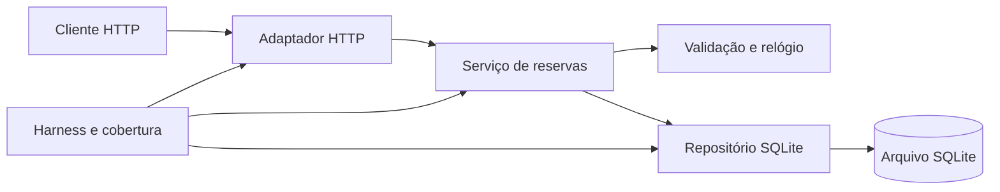

# ReservaLab

API local de reservas de salas: catálogo, criação/listagem, conflito de horários e cancelamento com histórico. Python >=3.12, SQLite, biblioteca padrão e unittest. Demonstração acadêmica local; usar dados fictícios.

**Entrega 3:** [Issue central #21](https://github.com/herethere04/reservalab-sdd/issues/21) · [SDD As-Built](docs/AS_BUILT.md) · [SPEC](docs/SPEC.md) · [encerramento](docs/ENTREGA_3.md).
**Estado em 20/10/2026:** candidato 1.0.0 em preparação; a integração da Entrega 2 terminou em main pelo PR #20. A release oficial e o vídeo da equipe ainda dependem das ações documentadas. Não confundir versão no código com tag já publicada.

## Equipe

| Integrante | RA | Fechamento da Entrega 3 |
| --- | --- | --- |
| Áquila de Brito Barbosa | 22453948 | Identificação da equipe e submissão conforme disciplina |
| Gabriel Ferreira Costa | 22450586 | As-Built, revisão e PDF final ([#22](https://github.com/herethere04/reservalab-sdd/issues/22)) |
| Pedro Ivo Gonçalves Pinheiro Coelho | 22453629 | Testes, cobertura e empacotamento ([#23](https://github.com/herethere04/reservalab-sdd/issues/23)) |
| Eduardo Cabral Nunes | 22454089 | Vídeo, retrospectiva e conferência da release ([#24](https://github.com/herethere04/reservalab-sdd/issues/24)) |

Preparação técnica assistida pelo Codex. As tarefas humanas acima não são declaradas concluídas antes de seus registros reais. Nomes e RAs publicados com autorização; testes e demonstrações usam dados fictícios.

## Instalação e execução local

Git e Python 3.12 ou superior. Nenhuma biblioteca Python externa, chave de API ou variável de ambiente é obrigatória para aplicação, testes ou cobertura.

```sh
git clone https://github.com/herethere04/reservalab-sdd.git
cd reservalab-sdd
python3 -m reservalab --host 127.0.0.1 --port 8000 --db data/reservalab.db
```

Durante a preparação, a proposta está em `feature/entrega-3-final`; após a homologação, usar main ou o código-fonte da release v1.0.0. No Windows, usar `python` ou `py -3` no lugar de `python3`. Ctrl+C encerra e fecha o servidor. O diretório/banco SQLite é criado automaticamente.

| Argumento | Padrão | Efeito |
| --- | --- | --- |
| --host | 127.0.0.1 | Interface de escuta; manter local na demonstração. |
| --port | 8000 | Porta HTTP. |
| --db | data/reservalab.db | Arquivo persistente SQLite; :memory: não é suportado. |
| --version | - | Exibe ReservaLab 1.0.0 e termina. |

Não há `.env` necessário nem segredos a preencher. `PYTHONDONTWRITEBYTECODE` e `PYTHONUNBUFFERED` no contêiner são opções do Python, não credenciais. Consulte [health](http://127.0.0.1:8000/health) e [rooms](http://127.0.0.1:8000/rooms) depois de iniciar.

## Ambiente padronizado e comandos únicos

Docker Engine/Desktop com contêineres Linux e Compose. Imagem fixa **Python 3.13.7**, usuário sem privilégios. Cada comando constrói a imagem se necessário:

```sh
docker compose up --build -d api
docker compose run --build --rm tests
docker compose run --build --rm coverage
```

API em 127.0.0.1:8000. Banco no volume `booking-data`; `docker compose down` para sem apagar esse volume. O primeiro build pode precisar de internet para obter a imagem. O harness usa somente recursos locais e bancos temporários.

Teste: `evidence/latest/tests.log` e `summary.json`. Cobertura: `evidence/coverage/index.html`, `coverage.json`, `coverage.md`, fontes `.cover` e subdiretório `tests/` com a execução real.

Se o diretório não permitir escrita no Linux, executar o serviço de teste/cobertura com o UID/GID do usuário anfitrião (PowerShell exige sintaxe própria):

```sh
docker compose run --build --rm --user "$(id -u):$(id -g)" coverage
```

Se o Docker Desktop recusar o caminho, compartilhar a pasta do projeto nas configurações do Desktop ou usar a alternativa local abaixo. Registrar a restrição e o comando realmente executado; não declarar sucesso de um comando que falhou.

## Testes, cobertura e demonstração sem dependências externas

```sh
python3 scripts/run_tests.py --output-dir evidence/latest
python3 scripts/run_coverage.py --output-dir evidence/coverage
python3 scripts/demo.py
```

A cobertura executa o mesmo harness uma vez e mede todos os módulos de `reservalab`, inclusive não importados. O agregado crítico reúne domínio, serviço, repositório e HTTP. A metodologia usa eventos de linha de `trace` e tabelas de linha do bytecode CPython, excluindo docstrings; inclui threads HTTP criadas durante a suíte. Relata linhas ausentes e SHA-256 dos fontes. Não mede branches, bibliotecas externas/nativas ou subprocessos de fixtures.

**100% de passagem dos testes é diferente de cobertura de código.** Percentuais e contagens finais estão nos [relatórios reais](evidence/entrega3-local/coverage.md) e no [relatório de execução](docs/EXECUTION.md), sem presumir 100% de cobertura ou ausência de defeitos.

O workflow de PR mantém o check obrigatório `harness`, constrói o ambiente e publica testes/cobertura por 30 dias. As evidências da release têm retenção de 90 dias no Actions e cópias nos anexos da release. Não se alterou teste para esconder erro.

`demo.py` faz oito etapas HTTP reais em banco temporário: saúde, catálogo, criação, conflito, cancelamento, liberação do horário, capacidade e histórico. [Roteiro do vídeo](docs/DEMO.md), de 3 a 5 minutos, atribuído a eddyocn.

## API e arquitetura definitiva

| Método/rota | Contrato principal |
| --- | --- |
| GET /health | 200, status ok |
| GET /rooms | 200, duas salas com capacidades 4 e 8 |
| POST /bookings | 201, reserva; 409 em conflito; validações da SPEC |
| GET /bookings | 200, reservas ativas/canceladas |
| DELETE /bookings/{id} | 200, cancelamento idempotente; 404 inexistente |

```json
{"room_id":1,"student_name":"Grupo Exemplo","starts_at":"2099-10-25T14:00:00-03:00","ends_at":"2099-10-25T15:00:00-03:00","participants":3}
```

Na criação, enviar JSON UTF-8 e Content-Type application/json; datas futuras com fuso explícito e minuto inteiro, duração 30-120 min, participantes dentro da capacidade. Persistência UTC e intervalos [início,fim): adjacência permitida. Campos extras/ausentes e booleanos como inteiros são recusados. Erros, esquema, limites e rastreabilidade em [SPEC](docs/SPEC.md) e [AS_BUILT](docs/AS_BUILT.md).



Consulta de conflito e inserção usam a mesma transação `BEGIN IMMEDIATE`. Conexão por operação, escritores serializados, relógio/banco substituíveis em testes. Decisões e trade-offs em [ARCHITECTURE.md](docs/ARCHITECTURE.md); refinamentos finais em [ENTREGA_3_REFINEMENT.md](docs/ENTREGA_3_REFINEMENT.md).

## Release, vídeo e PDF de encerramento

[Guia da publicação oficial](docs/RELEASE.md). Depois de revisão e integração em main, com o vídeo real acessível, executar o workflow manual **Release final v1.0.0** na branch main. Ele verifica as condições, repete testes/cobertura, gera PDF final/pacote/checksums e publica a release vinculada ao commit testado. Não faz commit direto em main e não substitui aprovação humana.

A release prevista é `https://github.com/herethere04/reservalab-sdd/releases/tag/v1.0.0`; esse endereço só é evidência depois da publicação. O PDF definitivo será o anexo **ReservaLab_Entrega_3.pdf** da release. O documento `ReservaLab_Entrega_3_PREPARACAO.pdf` é uma prévia marcada e não deve ser enviado ao professor.

Para gerar uma prévia local, separadamente da API:

```sh
python3 -m venv .report-venv
.report-venv/bin/python -m pip install -r scripts/requirements-report.txt
.report-venv/bin/python scripts/build_final_report.py --evidence-dir evidence/coverage --output output/pdf/ReservaLab_Entrega_3_PREPARACAO.pdf --draft
```

No Windows, o Python do ambiente fica em `.report-venv\Scripts\python.exe`. A dependência ReportLab é somente documental. Na release, o vídeo informado deve estar entre 3 e 5 minutos e acessível ao professor; o responsável confirma esse acesso e a homologação real.

## Governança e limites do uso de IA

Fluxo: feature/* → develop → main por PR com revisão de outra pessoa e check harness aprovado. A main deve permanecer protegida; o workflow de release rejeita PRs abertos ou tag existente. Histórico verificado em [GOVERNANCE.md](docs/GOVERNANCE.md), tarefas em [TEAM.md](docs/TEAM.md) e checklist em [DELIVERY_CHECKLIST.md](docs/DELIVERY_CHECKLIST.md).

Somente Codex teve uso informado pela equipe. Os artefatos e testes evidenciam apoio; não houve medição controlada de ganho percentual de produtividade. A retrospectiva distingue resultado verificável de hipótese. Não se fabricam autoria, execução, revisão, gravação, release ou envio acadêmico de colegas.

Sem autenticação, autorização por dono da reserva, frontend, TLS próprio, limitação de requisições ou integração institucional. `http.server` é apropriado à demonstração local, sem garantia de produção. Não coletar dados institucionais reais. [Relatório da Entrega 2](docs/ENTREGA_2.md) preserva a discussão ético-técnica anterior.
