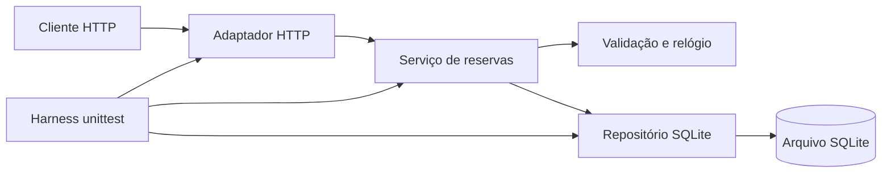

# ReservaLab

API local de reserva de salas: consulta catálogo, cria e lista reservas, impede sobreposição e cancela preservando o registro. Projeto acadêmico com Python, SQLite, biblioteca padrão, unittest e fluxo SDD.

**Repositório:** [herethere04/reservalab-sdd](https://github.com/herethere04/reservalab-sdd).
**Entrega 2:** [relatório](docs/ENTREGA_2.md), [PDF](output/pdf/ReservaLab_Entrega_2.pdf) e [Issue #14](https://github.com/herethere04/reservalab-sdd/issues/14).
**Estado:** proposta em `feature/entrega-2`, baseada em `develop`, sujeita a revisão humana. A aplicação funcional já existe em `main`; #9, #10 e #12 foram integrados em `develop`. A promoção #13 está aberta na consulta de 14/10/2026.

## Equipe

| Integrante | RA | Área |
| --- | --- | --- |
| Áquila de Brito Barbosa | 22453948 | Integração, governança e entrega |
| Gabriel Ferreira Costa | 22450586 | Especificação e contratos |
| Pedro Ivo Gonçalves Pinheiro Coelho | 22453629 | Regras e persistência |
| Eduardo Cabral Nunes | 22454089 | Ambiente, harness e evidências |

As contribuições verificadas e seus limites estão em [GOVERNANCE.md](docs/GOVERNANCE.md). Os nomes/RAs identificam a equipe real; os fixtures usam dados fictícios.

## Instalação e execução local

Requisitos: Git e Python **3.12 ou superior**. Não é necessário instalar pacote Python externo, banco separado ou runtime de IA.

```sh
git clone https://github.com/herethere04/reservalab-sdd.git
cd reservalab-sdd
git switch feature/entrega-2
python3 --version
python3 scripts/run_tests.py --output-dir evidence/latest
python3 -m reservalab --host 127.0.0.1 --port 8000 --db data/reservalab.db
```

A branch acima contém a proposta da entrega; após a promoção aprovada, selecionar `main`. Se o executável se chama `python`, substituir `python3`; no Windows, `py -3` também pode ser usado. Encerre a API com Ctrl+C. O banco é criado automaticamente. Consulte [health](http://127.0.0.1:8000/health) ou [rooms](http://127.0.0.1:8000/rooms) para receber JSON.

## Ambiente padronizado com Docker

Inicie Docker Desktop/Engine com contêineres Linux e Docker Compose. A imagem fixa **Python 3.13.7** e executa a API com usuário sem privilégios.

```sh
docker compose run --build --rm tests
docker compose up --build -d api
docker compose logs api
docker compose down
```

Os testes gravam `evidence/latest/tests.log` e `summary.json`. A API fica em `127.0.0.1:8000`; o volume do banco é preservado por `docker compose down`. O download inicial da imagem exige internet; os cenários de teste usam apenas recursos locais.

Em Linux, se o UID 10001 do contêiner não puder gravar no diretório de evidências do anfitrião, execute somente o serviço de testes com seu UID/GID:

```sh
docker compose run --build --rm --user "$(id -u):$(id -g)" tests
```

No CI, o diretório de evidências é preparado antes da execução. Não é necessário executar a API como root nem alterar permissões de todo o projeto.

## Contrato e exemplo

| Método e rota | Resultado |
| --- | --- |
| GET /health | 200, status operacional |
| GET /rooms | 200, duas salas, capacidades 4 e 8 |
| POST /bookings | 201, reserva ativa; 409, conflito |
| GET /bookings | 200, reservas ativas e canceladas |
| DELETE /bookings/{id} | 200, cancelamento idempotente; 404, inexistente |

Corpo de POST /bookings com Content-Type application/json:

```json
{"room_id":1,"student_name":"Estudante Exemplo","starts_at":"2099-10-10T14:00:00-03:00","ends_at":"2099-10-10T15:00:00-03:00","participants":3}
```

Datas com fuso explícito e minutos inteiros; resposta em UTC com Z. Duração de 30 a 120 minutos, início não passado e capacidade respeitada. Apenas reservas ativas da mesma sala bloqueiam horários; adjacência é permitida. Campos ausentes/extras e booleanos como inteiros são recusados. Contrato de erros e regras completas em [SPEC.md](docs/SPEC.md).

## Arquitetura e decisões



O domínio é independente de HTTP. Consulta de conflito e inserção usam a mesma transação `BEGIN IMMEDIATE`, com conexão por operação e datas UTC.

| ADR | Decisão | Justificativa e limite |
| --- | --- | --- |
| 001 | Python e biblioteca padrão | Reprodução simples; servidor para demonstração local |
| 002 | SQLite e transação única | Evitar corrida; escritores serializados |
| 003 | UTC e intervalos semiabertos | Fusos equivalentes e adjacência; cliente converte exibição |
| 004 | Cancelamento lógico idempotente | Histórico simples; não é auditoria completa |
| 005 | Relógio injetável e banco isolado | Testes determinísticos; não comprova carga |
| 006 | PR revisado e evidência autêntica | Rastreabilidade; precisa de ações humanas reais |

Contexto, consequências e defesa em [ARCHITECTURE.md](docs/ARCHITECTURE.md) e [ENTREGA_2.md](docs/ENTREGA_2.md).

## Testes e refinamento

```sh
python3 scripts/run_tests.py --output-dir evidence/latest
```

A suíte tem **50 testes**: 32 de serviço/persistência, 14 HTTP e quatro do processo real do harness. A execução local da Entrega 2 em CPython 3.12.3/Linux terminou com **0 falhas, 0 erros, 0 ignorados e saída 0**.

A mesma suíte também passou no Docker com CPython 3.13.7: 50 testes, zero falhas/erros. [Log Docker](evidence/entrega2-docker/tests.log) e [resumo](evidence/entrega2-docker/summary.json).

[Log local](evidence/entrega2-local/tests.log) · [Resumo/hashes](evidence/entrega2-local/summary.json) · [Relatório de execução](docs/EXECUTION.md).

Os quatro novos testes comprovam sucesso, falha de asserção, exceção e suíte vazia em projetos temporários. As falhas deliberadas são fixtures isoladas; todos os testes da suíte principal passam. O harness registra ambiente, data, HEAD, estado da árvore e manifesto SHA-256. Não se declara cobertura percentual.

O [workflow](.github/workflows/tests.yml) executa a suíte em Python 3.13.7 dentro do Docker e publica evidências por 30 dias. Os logs atuais também ficam versionados. Conferir o check do novo PR antes de integrar.

[REFINEMENTS.md](docs/REFINEMENTS.md) distingue esclarecimentos iniciais, quatro erros concretos corrigidos, validações humanas e refinamentos da Entrega 2. Os contratos HTTP e a implementação funcional foram preservados; a nova etapa reforça a comprovação do harness e corrige a documentação.

## Governança, IA e entrega

Fluxo exigido: `feature/* -> develop -> main`, por PR, revisão de outro integrante e check harness aprovado. A auditoria registra uma exceção real: o PR #11 teve base main; #13 está aberto. Aprovações históricas não aprovam esta proposta. As proteções registradas em setembro não foram reconsultadas nesta etapa.

O Codex apoiou especificação, código, testes e revisão na preparação inicial. Na Entrega 2, apoiou inspeção do GitHub, testes, documentação e PDF, sem subagentes. [AGENTS.md](AGENTS.md) e [AI_WORKFLOW.md](docs/AI_WORKFLOW.md) documentam o fluxo; o relatório analisa alucinações, prompt injection, permissões, privacidade, autoria e aprendizagem. A responsabilidade e a aprovação são humanas.

| Item da Entrega 2 | Evidência |
| --- | --- |
| Solução publicada e governança | Código, Issues/PRs e [auditoria](docs/GOVERNANCE.md) |
| Testes e casos de borda | 50 testes, logs e resumo atual |
| Erros, correções e re-especificação | SPEC e REFINEMENTS |
| README, fluxo e defesa | Este arquivo, diagrama e ADRs |
| Relato técnico da experiência | Seção 9 do relatório, baseada no histórico |
| Análise crítica de IA | Seções 7 e 8 do relatório |
| Documento acadêmico | [PDF da Entrega 2](output/pdf/ReservaLab_Entrega_2.pdf) |
| Revisão e integração final | Pendentes de revisão do novo PR e promoção aprovada |

Antes de submeter, concluir [DELIVERY_CHECKLIST.md](docs/DELIVERY_CHECKLIST.md). Cada integrante confere e envia o documento conforme a orientação da disciplina.

Demonstração acadêmica local: sem autenticação, autorização por usuário, frontend ou integração institucional. O código publicado não representa hospedagem pública do serviço.
